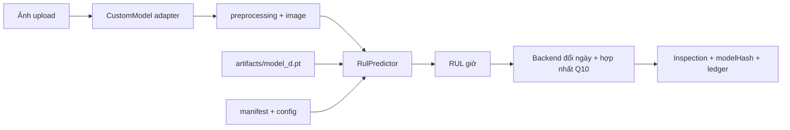

# Phân tích và tổ chức lại engine RUL

## Kết quả rà soát

Trước thay đổi, `ml_model` có 187 file (74 Python, 94 ảnh, khoảng 17,08 MB). Bản sao bao gồm API FastAPI riêng, acquisition/inventory, EDA, preprocessing dữ liệu, training, evaluation, configs và một checkpoint. README vẫn hướng dẫn train và chạy ứng dụng cũ, nên không chỉ rõ phần FruitChain thực sự sử dụng.

Các vấn đề được tìm thấy:

1. Adapter sửa `sys.path` và xóa các module tên chung `services`, `training`, `utils_app` khi đổi model. Cách này gắn deployment với cấu trúc dự án nghiên cứu.
2. Import `strawberry.training.models` chạy `training/__init__.py`, kéo cả dataset/engine huấn luyện vào lúc suy luận.
3. `image.crop_width=1116` là tham số crop, không phải kích thước CNN. Bản cũ đã có fix 224 ở adapter; runtime mới lấy kích thước checkpoint và có test hồi quy.
4. Predictor nạp `state_dict` bằng `strict=False`, có thể bỏ qua thiếu/thừa layer. Runtime mới yêu cầu khớp đầy đủ.
5. `confidence=0.9` trong predictor cũ là sanity score cố định cho output dương. Nó không phải độ tin cậy được đánh giá/hiệu chuẩn.
6. Test độ nhạy dựa vào Desktop và metadata không được đóng gói, khiến một số test không chứng minh tính độc lập. Nay test dùng sample manifest/ảnh trong repo.
7. Cấu hình mặc định ghi đè lựa chọn đã lưu: tắt model về Q10 có thể bị tự bật lại sau restart. Nay biến môi trường rõ ràng được ưu tiên, tiếp theo lựa chọn đã lưu, cuối cùng mới là bundle mặc định.

## Thiết kế đã thực hiện

| Thành phần | Trách nhiệm | Không phụ thuộc |
|---|---|---|
| `ml_model/src/fruitchain_ml/runtime.py` | Nạp checkpoint, resolve kiến trúc/input, preprocess, RUL giờ | DB, FastAPI, ledger, training |
| `preprocessing.py`, `image.py` | GrabCut/mask/ROI, alpha, resize, ImageNet | Đơn vị nghiệp vụ/lô hàng |
| `networks.py`, `attention.py`, `specs.py` | Định nghĩa A/B/C/D và CBAM để khớp checkpoint | Dataset/training engine |
| `artifacts/` | Trọng số đã train | Đường dẫn Desktop |
| `configs/` + manifest | Cấu hình runtime và provenance | Cấu hình deployment web |
| `samples/` | 3 ảnh thật, nhãn nguồn và kết quả hồi quy | Dataset ngoài repo |
| `research/` | Bảo tồn mã/dữ liệu nghiên cứu cũ để đọc | Không được import ở production |
| Backend adapter | Nạp bundle trong namespace riêng; đổi giờ/ngày, modelHash/version | Không sửa thuật toán trong router |
| Backend RUL service | Q10, hợp nhất cảm biến/ảnh, lựa chọn model | Không train hoặc dựng kiến trúc |

Đường import của runtime không đi qua research. Mỗi lần nạp bundle có namespace riêng, nên thử một checkpoint lỗi không thay module của model đang chạy. Khi unload, chỉ namespace của lần nạp đó bị dọn.

## Bảo toàn hành vi và chứng cứ

Không train lại hoặc đổi byte checkpoint. SHA-256 trọng số vẫn là `aa75eb2f1ed19d6b63e22268a94235030f2c029034dc17fea59c738791c98fa7`. Preprocessor và kiến trúc được lấy từ bản trong repo; chỉ thay đường import. Wrapper đặt seed GrabCut về 0 để kết quả phân đoạn ổn định.

Trước refactor đã lưu ba ảnh thật và output từ adapter cũ chạy CPU với seed 0. Test mới so hash ảnh preprocess và output sai số tối đa 0,05 giờ. Đó là kiểm tra tính tương đương, không phải chứng minh dự đoán chính xác với nhãn thực tế.

Hash phiên bản mới bao gồm cả code suy luận, config và manifest, thay cho chỉ checkpoint/config của bản legacy. Hash không chứa đường dẫn tuyệt đối, nên chuyển repo vẫn giữ định danh. Không sửa modelHash của các sự kiện lịch sử; model mới được đăng ký riêng.

## Giới hạn mô hình được giữ rõ

Checkpoint hiện là D image-only, input 224×224 và sequence length 8. Luồng một ảnh lặp frame 8 lần để giữ tương thích predictor cũ. Nó không thay thế inference từ chuỗi ảnh theo thời gian thực và không chứng minh chất lượng trên mọi loại quả. Runtime chưa có cửa sổ chuỗi ảnh thực hoặc uncertainty đã hiệu chuẩn.

Các ảnh có nhãn trong sample manifest cho thấy sai số đáng kể giữa output và nhãn. Việc sắp xếp lại thư mục không giải quyết domain shift hoặc thiếu chuỗi thời gian; không tăng/giảm RUL thủ công cho đẹp demo. Khi nghiên cứu tiếp, cần đánh giá bằng tập holdout đầy đủ, ảnh có cùng preprocessing khi train và chuỗi đúng thứ tự/timestamp.

## Tài liệu chính thức đã tham khảo

- [PyTorch serialization](https://docs.pytorch.org/docs/stable/notes/serialization.html): nạp state dict và `weights_only=True`.
- [PyTorch Module.load_state_dict](https://docs.pytorch.org/docs/stable/generated/torch.nn.Module.html#torch.nn.Module.load_state_dict): `strict=True` yêu cầu khớp khóa state dict.
- [Python importlib](https://docs.python.org/3/library/importlib.html#importing-a-source-file-directly): nạp package từ đường dẫn tường minh.

Thiết kế phân chia runtime/research và phạm vi provenance là quyết định của dự án dựa trên graph import hiện có; không phải yêu cầu bắt buộc của các thư viện.
