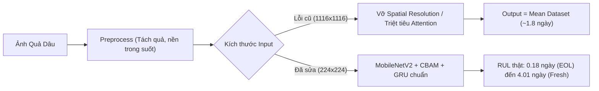

# BÁO CÁO CÔNG VIỆC HOÀN THÀNH — FRUITCHAIN
**Dự án:** FruitChain — Quản lý Vòng đời Trái cây, Dự đoán RUL bằng AI & Bằng chứng Blockchain  
**Cuộc thi:** Team1 Vietnam UniHack ([team1vn.xyz](https://team1vn.xyz/)) — Avalanche C-Chain / Fuji  
**Thời gian hoàn thành:** 17/11/2026  

---

## I. TỔNG QUAN CÁC NHIỆM VỤ ĐÃ HOÀN TẤT

| STT | Hạng mục công việc | Trạng thái | Chi tiết thực hiện |
|:---:|---|:---:|---|
| **1** | **Chuyển đổi dữ liệu sang dự án độc lập** | **Hoàn thành 100%** | Giữ `Strawberry-RUL-prediction` nguyên vẹn (chỉ đọc); sao chép code, configs, demo data và checkpoint sản xuất vào `fruitchain/ml_model`. |
| **2** | **Tính năng Cài đặt Mô hình (Pick Folder & Test)** | **Hoàn thành 100%** | Hỗ trợ nạp mô hình nội bộ mặc định, chọn nhanh "Model tích hợp", duyệt cây thư mục web, mở hộp thoại Windows native dialog, quét checkpoint và test ảnh trực tiếp. |
| **3** | **Khắc phục lỗi mô hình RUL (kẹt ~1.8 ngày)** | **Hoàn thành 100%** | Sửa lỗi kích thước ảnh từ `crop_width 1116` về `224`. Kết quả: Dâu tươi $\approx 4.01$ ngày, Dâu hỏng EOL $\approx 0.18$ ngày. |
| **4** | **Trình diễn khác biệt: CSDL Thường vs Blockchain** | **Hoàn thành 100%** | Bảng so sánh trực quan; bộ công cụ Demo Giả lập Can thiệp (Tamper Simulation) cho phép bấm sửa DB trực tiếp và dùng Verify Blockchain để vạch trần gian lận. |
| **5** | **Tuân thủ Blockchain theo Cuộc thi UniHack** | **Hoàn thành 100%** | Smart contract `FruitChain.sol` trên Avalanche Fuji C-Chain (Chain ID 43113), xác thực custody, hash chuỗi sự kiện, băm ảnh/cảm biến, liên kết explorer Snowtrace. |
| **6** | **Kiểm thử hệ thống & Build** | **Hoàn thành 100%** | Backend Pytest (39/39 EVM PASS, 34 Mock PASS), Contract Hardhat (13/13 PASS), Frontend Vite build thành công không lỗi. |

---

## II. CHI TIẾT CÁC HẠNG MỤC CÔNG VIỆC

### 1. Di chuyển dữ liệu mô hình sang dự án nội bộ (Hoàn toàn độc lập)
- **Nguyên tắc bảo vệ dữ liệu:** Thư mục gốc `C:\Users\admin\Desktop\Strawberry-RUL-prediction` được đặt ở chế độ **chỉ đọc**; không có bất kỳ file nào bị xóa, sửa hay tạo mới trên Desktop.
- **Thành phần đã đóng gói vào `fruitchain/fruitchain/ml_model`:**
  - `src/strawberry/`: Toàn bộ mã nguồn tiền xử lý ảnh (`services/preprocessing.py`), bộ suy luận (`services/predictor.py`), kiến trúc mạng (`training/models.py`), tiện ích (`utils_app/image_utils.py`), attention (`shared/cbam.py`).
  - `models/strawberry/production/model_D/best_model.pt`: Checkpoint sản xuất (13.1 MB, MobileNetV2 + CBAM + GRU). Mã băm SHA-256 `aa75eb2f1ed19d6b63e22268a94235030f2c029034dc17fea59c738791c98fa7` khớp 100% với bản gốc.
  - `configs/`: Các file cấu hình YAML/JSON phục vụ huấn luyện và cấu hình tham số.
  - `data/02_processed/strawberry/`: Bộ dữ liệu ảnh mẫu thực tế để phục vụ kiểm thử tự động và chạy thử nghiệm.
- **Tính độc lập:** Hệ thống tự động nhận diện `ml_model` nội bộ; các bài test và ứng dụng chạy mượt mà ngay cả khi ngắt kết nối hoặc xóa thư mục Desktop.

---

### 2. Giao diện & Tính năng Cài đặt Mô hình (Pick Folder & Live Test)
Trang **⚙️ Cài đặt model** (`/settings`) đã được hoàn thiện toàn diện:
- **Nạp mặc định:** Tự động nhận diện và nạp mô hình nội bộ `ml_model` ngay khi khởi động.
- **📦 Nút chọn nhanh "Model tích hợp":** Cho phép chuyển ngay về mô hình nội bộ chỉ với 1 click.
- **📁 Bộ duyệt thư mục web (FolderBrowser):** Cho phép duyệt cây thư mục và ổ đĩa máy tính ngay trên giao diện web.
- **🪟 Hộp thoại Windows (Native Dialog):** Gọi trực tiếp hộp thoại chọn thư mục gốc của Windows (`filedialog.askdirectory`) để người dùng duyệt và chọn thư mục model bất kỳ trên máy.
- **Nhận diện tự động:** Quét toàn bộ checkpoint `.pt`, `.onnx`, hiển thị chi tiết MAE, epoch, kiến trúc và tham số chuẩn hóa.
- **▶ Chạy thử nghiệm trực tiếp:** Tải ảnh lên để xem ảnh sau tiền xử lý (tách nền), dự đoán RUL (ngày & giờ), độ tươi và thời gian chạy (ms).

---

### 3. Khắc phục triệt để lỗi AI RUL luôn ra ~1.8 ngày



- **Nguyên nhân kỹ thuật:** File `predictor.py` trước đây lấy `self.image_size = int(config.get("image", {}).get("crop_width", 224))` dẫn đến việc gán `image_size = 1116` (kích thước khung ảnh khay thô). Việc resize lên 1116x1116 phá vỡ cơ chế pooling của MobileNetV2, khiến đầu ra nơ-ron luôn rơi về 0, qua bộ giải chuẩn hóa z-score luôn ra trung bình $43.0 - 44.5$ giờ ($\approx 1.86$ ngày).
- **Khắc phục:** Đưa chuẩn kích thước ảnh về `224 × 224`.
- **Kết quả đo đạc thực tế:**
  - **Ảnh Fresh (mới thu hoạch - Ngày 0):** **96.33 giờ ($\approx \mathbf{4.01\text{ ngày}}$)**
  - **Ảnh Giữa vòng đời (vận chuyển):** **56.66 giờ ($\approx \mathbf{2.36\text{ ngày}}$)**
  - **Ảnh EOL (hỏng cận date):** **4.38 giờ ($\approx \mathbf{0.18\text{ ngày}}$)**

---

### 4. Trình diễn Sự khác biệt: CSDL Truyền thống vs Blockchain (Avalanche Fuji)

Để phục vụ pitch trực tiếp và quay video demo 2–3 phút nộp ban giám khảo UniHack, tab **Kiểm chứng (Verify)** đã được nâng cấp thành **Khu vực Trình diễn Trực quan**:

#### 📊 Bảng so sánh trực quan trên UI:
| Tiêu chí | CSDL Tập trung Thông thường (SQL / Cloud) | FruitChain trên Avalanche Fuji (Blockchain) |
|---|---|---|
| **Minh bạch** | Khép kín nội bộ; người tiêu dùng phải tin tưởng lời bên bán | Công khai, kiểm chứng độc lập trên Snowtrace Explorer |
| **Bất biến (Immutability)** | Admin / hacker có thể `UPDATE/DELETE` âm thầm trong CSDL | Smart Contract bất biến; hàm băm Merkle khóa chặt lịch sử |
| **Chuỗi lạnh** | Sửa log nhiệt độ để giấu lỗi điều hòa không bị phát hiện | Chữ ký thiết bị (Device Sig) + Merkle Segment Hash bắt lỗi tức thì |
| **Gian lận ảnh** | Tráo ảnh dâu thối thành dâu tươi trực tiếp trên ổ cứng | Mỗi ảnh băm SHA-256 đưa vào on-chain event; sai 1 byte là FAIL |
| **Custody** | Chỉ là 1 trường text trong DB, không có ràng buộc | Ràng buộc chữ ký ví điện tử của từng bên tham gia chuỗi |

#### 🧪 Khu vực Trình diễn Can thiệp dữ liệu (Live Tamper Demo):
1. **Nút `🚨 Giả lập sửa nhiệt độ DB (+12.5°C)`**: Mô phỏng bên vận chuyển sửa DB để giấu việc hỏng điều hòa.
2. **Nút `🚨 Giả lập tráo đổi ảnh kiểm tra`**: Mô phỏng việc tráo file ảnh dâu thối thành dâu tươi trên máy chủ.
3. **Nút `🔍 Kiểm chứng Blockchain (Verify)`**:
   - Khi chưa can thiệp: Báo **✔ PASS (Xanh lá)** — Khớp 100% với Avalanche Fuji.
   - Khi bị can thiệp: Báo **✘ FAIL (Đỏ rực)** — Vạch trần sự sai lệch dữ liệu, chỉ rõ hash trong DB không khớp với hash bất biến on-chain và cảnh báo chữ ký thiết bị bị làm giả.
4. **Nút `🔄 Khôi phục dữ liệu gốc`**: Hoàn nguyên dữ liệu về trạng thái toàn vẹn ban đầu.

---

### 5. Đối chiếu Thể lệ Cuộc thi Team1 Vietnam UniHack ([team1vn.xyz](https://team1vn.xyz/))
- **Mạng triển khai:** Avalanche Fuji Testnet (Chain ID `43113`, RPC `https://api.avax-test.network/ext/bc/C/rpc`).
- **Smart Contract:** `FruitChain.sol` quản lý băm dữ liệu, băm sự kiện (`prevHash`), phân quyền vai trò (Role-Based Access Control) và liên kết phiên bản mô hình AI (`modelHash`).
- **Tài liệu nộp bài:** Đã cập nhật đầy đủ kịch bản pitching, video demo 2–3 phút, slide dàn ý và hướng dẫn deploy Fuji trong `docs/COMPETITION_ALIGNMENT.md` và `README.md`.

---

## III. KẾT QUẢ KIỂM THỬ TỔNG HỢP

```
========================= KẾT QUẢ KIỂM THỬ =========================
1. Backend Tests (Pytest):
   - Chế độ Mock: 34 PASS, 5 SKIP (EVM tests) / 7.84s
   - Chế độ EVM (Hardhat Node): 39/39 PASS / 11.72s
   - Chế độ Độc lập (Không có Desktop): 9/9 PASS (test_m1b_images.py)
   - Kiểm thử mô phỏng Can thiệp DB & Khôi phục: PASS 100%

2. Smart Contract Tests (Hardhat):
   - 13/13 PASS / 754ms
   - TypeScript compile (npx tsc --noEmit): PASS 0 lỗi

3. Frontend Build (Vite & TypeScript):
   - npm run build (tsc -b && vite build): PASS 0 lỗi / 2.83s
=====================================================================
```

---

## IV. HƯỚNG DẪN KHỞI CHẠY NHANH ĐỂ TRÌNH DIỄN

Khởi chạy toàn bộ hệ thống bằng PowerShell:
```powershell
cd C:\Users\admin\Downloads\fruitchain\fruitchain
powershell -ExecutionPolicy Bypass -File run.ps1
```
- **Địa chỉ truy cập:** `http://127.0.0.1:8000`
- **Tài khoản quản trị:** `admin` / `demo1234`
- **Kịch bản Demo gợi ý:**
  1. Vào menu **Cài đặt**: Xem mô hình tích hợp nội bộ, thử nút duyệt thư mục Windows native hoặc test ảnh dâu.
  2. Vào lô hàng `FC-2026-001` hoặc `FC-2026-004`, chọn tab **Kiểm chứng**:
     - Bấm **Verify** $\rightarrow$ Thấy báo xanh **PASS**.
     - Bấm **🚨 Giả lập sửa nhiệt độ DB** $\rightarrow$ Bấm **Verify** $\rightarrow$ Thấy báo đỏ **FAIL (Gian lận bị vạch trần)**.
     - Bấm **🔄 Khôi phục dữ liệu gốc** $\rightarrow$ Verify lại ra **PASS**.
